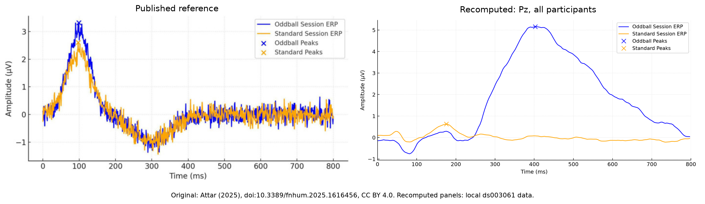

# EG-based-characterization-of-auditory-attention-and-meditation

Full-dataset auditory oddball analysis using **hu-neuro-pipeline**, with ERP, peak, scalp-map and power-spectrum figures and comparisons with [Attar (2025)](https://pmc.ncbi.nlm.nih.gov/articles/PMC12417730/).

## Notebooks

Start Jupyter in this repository folder. The full-dataset notebook is independent of the earlier single-recording exploration:

1. **[figure replications.ipynb](figure%20replications.ipynb)** processes all 13 participants and 39 runs through `hu-neuro-pipeline.group_pipeline()`. It produces participant and grand averages, QC summaries, 12 primary figure sets and 17 paper-style comparison figures. Its final section can run independently against saved local library outputs.
2. **eeg exploration.ipynb** is the earlier subject 001/run 1 preprocessing exploration. It sets the BioSemi64 montage and average reference, applies a 1 Hz high-pass, and provides interactive ICA inspection. Its final cell saves `sub-001_run-1_clean_raw.fif`.
3. **analyisis.ipynb** analyzes that single cleaned recording, comparing sound-condition ERPs and scalp maps.

The analysis filename retains its original spelling.

## Setup

Create and activate a Python environment, then run:

```sh
python -m pip install -r requirements.txt
python -m jupyterlab
```

Select that environment as the notebook kernel. The existing dependency pins retain the original notebook environment; exact versions used for the completed full-data run are recorded in [results/software_versions.json](results/software_versions.json). Notebook installation cells are optional after installing requirements.

Download the full dataset for the group notebook:

```sh
python -c "import openneuro; openneuro.download(dataset='ds003061', target_dir='ds003061')"
```

Keep `.set` files and any companion `.fdt` files together. The full-data notebook creates numeric-trigger FIF inputs, matching trial logs and library derivatives under `hu_neuro_results/`. Allow several GB for source data and derivatives. Set `PROJECT_DIR` if the kernel starts outside the repository. Leave `RUN_PROCESSING=True` for the first run and after settings/input changes; use `False` to redraw existing results. The paper section has its own small channel-PSD cache.

The single-recording exploration can download subject 001 alone. Raw EEG, prepared inputs, FIF derivatives, caches, local backups and participant-level result exports are excluded from Git. Group-level PNG figures and aggregate CSV summaries from the executed analysis are included under [results/](results/README.md). Participant-specific reports and their preview plots are generated locally by the notebook.

## Data and interpretation

Data: **EEG data from an auditory oddball task**, Arnaud Delorme, [OpenNeuro ds003061, snapshot 1.1.2](https://openneuro.org/datasets/ds003061/versions/1.1.2), DOI [10.18112/openneuro.ds003061.v1.1.2](https://doi.org/10.18112/openneuro.ds003061.v1.1.2).

- The group workflow uses exactly the 64 scalp channels; auxiliary sensors, including `Temp`, do not enter its reference or averages.
- Group settings are average reference, 1 Hz high-pass, no low-pass, -200 to 800 ms epochs, -200 to 0 ms baseline and 200 microvolt peak-to-peak rejection. ICA is disabled in the group run. Settings are explicit in the notebook and [results/analysis_settings.json](results/analysis_settings.json).
- ICA exclusions `[0, 4, 6]` belong to the earlier single-recording exploration. Component numbering can change when ICA is fitted again; review the component plots and overlays before using those exclusions.
- Response-tagged sound annotations are grouped with their sound condition, including the dataset spelling `reponse`.
- The library pools runs within each participant before averaging participants equally. Its saved epochs omit the endpoint sample, giving 256 time points. PSDs are averaged in linear power before conversion to dB.
- The run retained 25,550 of 28,425 epoched trials. Another 27 sound windows extend beyond recording edges. Eleven run/condition rows are flagged for QC review. See [results/run_summary.json](results/run_summary.json); detailed participant-level QC remains local.

## Paper comparisons

The paper section matches layouts and shows numerical differences. It includes attributed original images, approximate image-digitized waveform/spectrum traces, five-position and all-participant bar panels, and both ERP and spectrum interpretations of the ambiguous maps. [Figure-by-figure status](results/paper_comparison/reproduction_status.csv) records what can be compared. Bar panels with individual participant measurements and their mappings remain local; the published previews show group-level comparisons.



These are layout comparisons rather than a verified numerical reproduction. Author-specific cleaning decisions, the ERP plotting channel and the five-position participant mapping are incompletely specified. Figures 4-5 have spectral image titles and ERP captions. Meditation/cognitive state labels and author classifier predictions are unavailable locally; Figures 8-11 are labeled simulations. The notebook retains those images as references.

Original paper images are credited to Attar ET (2025), *Frontiers in Human Neuroscience* 19:1616456, [doi:10.3389/fnhum.2025.1616456](https://doi.org/10.3389/fnhum.2025.1616456), under [CC BY 4.0](https://creativecommons.org/licenses/by/4.0/). See [paper_references/README.md](paper_references/README.md) and its source/hash manifest. Digitized traces are approximate image measurements; published and local PSD normalization are not assumed interchangeable.

Uploaded notebook outputs are cleared for readable version control. The executed local notebooks and their outputs are preserved locally; committed PNG previews and numerical reports provide the completed results.
